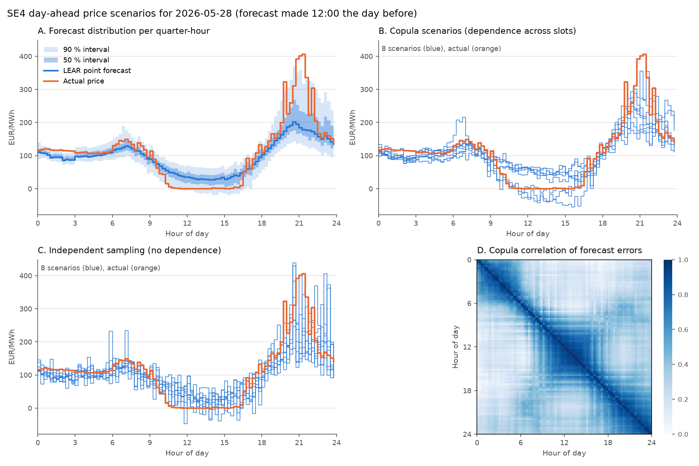

# Battery bidding in the Swedish day-ahead market (SE4)

**Summary.** This project studies how much a grid-scale battery
(10 MW / 20 MWh) can earn by trading in the day-ahead electricity market in
bidding zone SE4 (southern Sweden, around Malmö), and which forecasting and
bidding methods capture that value. Each strategy is backtested over 650
days (January 2025 to October 2026) on days the models had not seen, with
profits settled at real prices. Main findings:

- A LASSO-based price forecast (LEAR) captures **82 %** of the profit
  available with perfect foresight (1,492 vs 1,814 EUR/day after wear),
  against 67 % for the naive forecast "tomorrow's prices equal today's".
- Bidding price-dependent curves based on probabilistic price scenarios adds
  **nothing measurable** over a fixed schedule (+0.6 ± 2.1 EUR/day). For
  this battery the value lies in forecasting the daily price shape.
- **Battery wear** has to be priced into the decisions: planning without it
  would cycle 1.9 times a day instead of 1.3 and lose about 180 EUR/day.

**Status:** work in progress. Next steps are combining day-ahead trading
with a frequency reserve market and the project economics (see
*Conclusions and future work*).

## 1. Introduction

A battery earns money on electricity markets by buying energy when it is
cheap and selling it when it is expensive. The largest market for this is
the day-ahead market, where prices for every period of the next day are set
in one auction. This project asks three questions for a battery in SE4:

1. How much could it earn with perfect knowledge of tomorrow's prices?
2. How much of that does a good price forecast capture in practice?
3. Is it worth modelling the uncertainty of the forecast and bidding in a
   way that reacts to the actual prices?

### How the day-ahead market works

Each day before 12:00 CET (Central European Time; this deadline is called
gate closure), market participants submit bids to the Nord Pool day-ahead
auction for each of the next day's 96 quarter-hours (24 hours before
2025-10-01). Below, D denotes the delivery day and D-1, D-2, ... the days
before it.

**What a bid is.** For one delivery period, a bid is a list of
price-quantity pairs: how much energy the operator is willing to sell
(discharge) or buy (charge) at each price. For example:

| Price (EUR/MWh) | ≤ 20 | 70 | 120 | ≥ 200 |
|---|---:|---:|---:|---:|
| Net quantity (MW) | buy 10 | 0 | sell 8 | sell 10 |

Quantities between the listed prices are interpolated linearly: at 95,
halfway between 70 and 120, the bid is to sell 4 MW. A sell quantity at 120
means "willing to sell at any price of 120 or more". A fixed schedule ("sell
8 MW at 18:00 whatever the price") is the special case of a flat curve.

**What happens next.** At about 12:45 the auction publishes one clearing
price per period for the whole zone. Each bid is then a binding commitment:
if the 18:00-18:15 price clears at 120, the operator *must* sell 8 MW during
that quarter-hour (2 MWh), and is paid the clearing price for every MWh. All
participants get the same clearing price, not the price they bid (uniform
pricing). Delivering less than committed has to be settled in the imbalance
market, typically at a worse price.

So bids must be fixed before the prices are known. Profit depends on the
realized prices, the battery's physical limits and how the bids handle the
uncertainty about prices.

### The battery

All results use one hypothetical battery:

| Parameter | Symbol | Value |
|---|---|---|
| Power rating (max charge or discharge power) | P | 10 MW |
| Energy capacity | E | 20 MWh |
| Usable state of charge (SoC) | | 5-95 % of E, i.e. 1-19 MWh |
| Round-trip efficiency (charge and discharge losses split evenly) | η_c, η_d | 90 % (√0.9 ≈ 0.95 each way) |
| SoC at the start of the backtest | | 50 % (10 MWh) |
| Wear cost per MWh discharged | κ | 15 EUR/MWh (Appendix C) |

The battery is assumed small enough that its bids do not move the market
price (price-taker).

## 2. Method

### 2.1 Backtest setup

Every strategy is run day by day from 2025-01-01 to 2026-10-12 (650 days),
covering the switch from hourly to 15-minute market periods on 2025-10-01.

- **Only information available at gate closure.** For delivery day D, a
  strategy sees D-1's prices and earlier, plus forecasts of load and wind
  published before gate closure; it never sees D's prices. Models are
  trained only on past days.
- **Settlement at real prices.** The bids are settled against the actual
  clearing prices, and the battery's state of charge carries over from one
  day to the next.
- **The market's own time grid.** Each day has the periods the market
  actually had: hourly before 2025-10-01, quarter-hourly after, and 23 or 25
  hours on the daylight-saving-time changeover days.
- **Profit is reported after wear.** The wear charge represents used-up
  battery life and is a decision cost, not a cash expense. Payback and net
  present value (NPV, the sum of future cash flows discounted to today)
  belong to the project economics, which use cash flows instead.

Data comes from the ENTSO-E Transparency Platform (Appendix F).

### 2.2 Daily optimization

Each day before gate closure, the optimizer chooses tomorrow's charging and
discharging to maximize tomorrow's profit: market revenue minus the cost of
battery wear. It is a linear program (LP) with the battery limits of
Section 1:

- **Power:** charging power c and discharging power d are tracked
  separately, because losses differ by direction. The battery can switch
  direction within a period, so the limit is a time budget, c + d ≤ P
  (Appendix D).
- **Energy:** the state of charge evolves with the efficiency losses and
  stays between 5 % and 95 %.
- **Wear cost.** Discharging wears the battery, so each MWh discharged costs
  κ = 15 EUR/MWh: the cost of replacing the cells, spread over the energy
  they can deliver in their life (Appendix C). This lets each daily decision
  weigh a trade against the battery life it uses up.

Each day starts from the state of charge at which the previous day ended,
which is known at gate closure: the previous day's bids and prices are
already fixed by then.

### 2.3 Price forecasts

- **Naive:** tomorrow's prices equal today's, period by period.
- **LEAR** (LASSO-Estimated AutoRegressive model; Uniejewski et al., 2016;
  Lago et al., 2021), the standard benchmark in day-ahead price forecasting.
  It is a linear regression of each quarter-hour's price on past prices of
  SE4 and its neighbouring zones, on the grid operator's load and wind
  forecasts, and on day-of-week indicators. It is fitted with LASSO, a
  penalty that sets most coefficients to zero, so the data picks the inputs
  that matter (about 48 of 344 per model). Prices are compressed with an
  asinh transform before fitting, which tames price spikes. There is one
  model per quarter-hour, refit weekly on the last two years. Details in
  Appendix A.

### 2.4 Bidding under uncertainty

A point forecast leads to a fixed schedule. But a bid can be a curve that
sells more if the price turns out high and buys more if it turns out low.
To optimize such curves, the uncertainty of the forecast must be known:

1. **Forecast a distribution:** for each quarter-hour, a range of likely
   prices around the LEAR forecast, taken from LEAR's own recent errors.
2. **Generate scenarios:** 50 plausible full-day price paths per day,
   consistent with those ranges and with how prices move together over the
   day. Errors in neighbouring quarter-hours are correlated (a deeper solar
   dip at 12:00 means a deeper one at 14:00), and this is captured with a
   Gaussian copula, the standard method in energy forecasting (Pinson et
   al., 2009).
3. **Optimize bid curves against all scenarios at once:** one LP per day
   chooses a curve for each quarter-hour (8 price points, non-decreasing
   quantities) to maximize the average profit over the scenarios, with the
   battery limits holding in every scenario. This is a two-stage stochastic
   program (Birge & Louveaux, 2011); the curve construction follows Fleten
   & Pettersen (2005).

If the actual prices clear an amount the battery cannot physically deliver
(for example, selling when nearly empty), the shortfall is settled as
imbalance at a 50 EUR/MWh penalty. Details in Appendix B. One day of
scenarios:



### 2.5 Strategies compared

| Strategy | Bid |
|---|---|
| Perfect foresight | fixed schedule optimized on the actual prices; an upper bound, not achievable |
| Naive | fixed schedule optimized on the naive forecast |
| LEAR | fixed schedule optimized on the LEAR forecast |
| Expected value | fixed schedule optimized on the average of the 50 scenarios |
| Stochastic curves | price-dependent curves optimized over the 50 scenarios |

The difference between the last two is the value of the stochastic
solution (VSS): what bidding curves that react to the actual price is worth.

## 3. Results

### 3.1 Forecast accuracy and profit

Profit after wear, 650 days. All strategies cycle about 1.3 times per day.

| Strategy | EUR/day | Share of perfect foresight<br>hourly era / 15-min era / overall |
|---|---:|---:|
| Perfect foresight | 1,814 | 100 % |
| Naive | 1,221 | 70 % / 65 % / 67 % |
| LEAR | 1,492 | 86 % / 80 % / 82 % |

Forecast accuracy as mean absolute error (MAE) in EUR/MWh, and relative MAE
(rMAE = LEAR's MAE divided by the naive forecast's MAE; below 1 means better
than naive):

| Era | Naive MAE | LEAR MAE | LEAR rMAE |
|---|---:|---:|---:|
| Hourly (Jan to Sep 2025) | 27.4 | 18.5 | 0.67 |
| 15-min (Oct 2025 onwards) | 36.3 | 21.9 | 0.60 |

- The daily price *shape* is so persistent that the naive forecast already
  captures about two thirds of the attainable value.
- A 40 % lower MAE buys 15 percentage points of profit: what matters for the
  battery is ranking cheap and expensive periods correctly, not the absolute
  error.
- In the 15-minute era both forecasts capture a smaller *share* of perfect
  foresight, but LEAR earns more in absolute terms (about 1,540 vs 1,425
  EUR/day). The benchmark rose because price variation within the hour
  became tradable (Section 3.2). The eras also differ in season and
  volatility, so this is not a controlled comparison.

### 3.2 The value of 15-minute resolution

Over the 15-minute era (2025-10-01 to 2026-10-12), with all schedules
settled at actual 15-minute prices:

| Strategy | EUR/day | Share of perfect foresight |
|---|---:|---:|
| Perfect foresight, 15-min | 1,930 | 100 % |
| Perfect foresight, hourly-constant schedules | 1,710 | 89 % |
| LEAR, 15-min forecast | 1,543 | 80 % |
| LEAR, forecast averaged to hourly | 1,479 | 77 % |

About 11 % of the attainable value lies within the hour. The 15-minute
forecast captures part of it: it beats its own hourly average by about
65 EUR/day and wins on 68 % of days.

### 3.3 Bidding under uncertainty

| Strategy (650 days, after wear) | EUR/day | Share of perfect foresight<br>hourly / 15-min | vs expected value (EUR/day) |
|---|---:|---:|---:|
| LEAR (= middle of the forecast distribution) | 1,493 | 86.1 % / 80.0 % | +9.2 ± 4.6 |
| Stochastic curves | 1,484 | 85.8 % / 79.4 % | +0.6 ± 2.1 |
| Expected value | 1,484 | 85.6 % / 79.4 % | 0 |

(± is one standard error over days.)

- **The value of the stochastic solution is zero within noise.** The curves
  beat the expected-value schedule by 0.6 ± 2.1 EUR/day. Imbalance from
  undeliverable cleared amounts cost only 0.7 EUR/day. With a lower wear
  cost (5 EUR/MWh) the gain was 2 EUR/day (0.1 %), so it is small either way.
- **The forecast median beats the forecast mean, marginally:** by 9 ± 5
  EUR/day, about two standard errors. For a fixed schedule profit is linear
  in price, so in theory the mean should do at least as well. On average
  the mean is in fact the better calibrated of the two (bias −1.0 vs −2.9
  EUR/MWh), so the difference likely comes from how errors are distributed
  within the day. This is open.
- The scenarios themselves are good: the 90 % price ranges contain the
  actual price 90 % of the time in the hourly era and 87 % in the
  15-minute era, and the correlated scenarios are clearly better than
  independently sampled ones (Appendix B).

### 3.4 Battery wear

To check the wear cost, the optimizer was run with a range of assumed wear
costs, and every run was charged the "true" cost afterwards (LEAR forecast,
650 days). The central true cost is 15 EUR/MWh; 8 and 22 bracket the
plausible range (Appendix C).

| Planning wear cost (EUR/MWh) | 0 | 5 | 10 | **15** | 20 | 30 | 50 |
|---|---:|---:|---:|---:|---:|---:|---:|
| Cycles per day | 1.9 | 1.6 | 1.4 | 1.3 | 1.2 | 1.1 | 0.8 |
| Profit at true 15 (EUR/day) | 1,313 | 1,434 | 1,473 | 1,492 | 1,495 | 1,465 | 1,326 |
| Profit at true 8 (EUR/day) | 1,584 | 1,655 | 1,674 | 1,678 | 1,670 | 1,620 | 1,444 |
| Profit at true 22 (EUR/day) | 1,041 | 1,213 | 1,272 | 1,306 | 1,321 | 1,310 | 1,209 |

- **Ignoring wear is expensive.** Planning without it cycles 1.9 times a day
  and loses about 180 EUR/day against planning with the true cost.
- **With forecasts, a slightly higher planning cost earns a little more.**
  With perfect foresight the best planning cost equals the true cost. With
  LEAR, planning with 20 instead of 15 earns about 3 EUR/day more. The
  optimizer selects cycles whose *forecast* spread beats the wear cost, and
  the marginal ones are often selected because the forecast overstated the
  spread; a higher planning cost skips them.
- **Wasting energy at negative prices never paid in SE4** (Appendix D): it
  would need prices below about −135 EUR/MWh, and the lowest SE4 price since
  2021 is −60 EUR/MWh.

### 3.5 Energy held overnight

A natural extra rule is to require each day to end with some energy in
stock, for example at least 50 % full. It turns out to be costly:

| Minimum level at end of day | Perfect foresight (EUR/day) | LEAR (EUR/day) | Average level at midnight |
|---|---:|---:|---:|
| 50 % | 1,701 | 1,343 | 10 MWh |
| 25 % | 1,777 | 1,438 | 5 MWh |
| 5 % (normal limit only) | 1,814 | 1,492 | 1 MWh |

With a 50 % minimum, the battery must refill after the evening peak *before*
midnight, at late-evening prices (83 EUR/MWh on average at 21-24h).
Without it, the battery ends the day nearly empty and refills *after*
midnight, in the cheapest hours of the night (59 EUR/MWh on average at
00-05h), still ahead of the morning peak. All results in this README use
the normal 5 % limit only.

## 4. Conclusions and future work

For a price-taking battery trading only day-ahead in SE4, the value comes
from forecasting the daily price shape. A standard LASSO forecast captures
about four fifths of the profit available with perfect foresight. Bidding
price-dependent curves adds nothing measurable: the battery earns from
spreads across the day, and a curve for one quarter-hour cannot react to the
prices of the others. Realistic wear costs matter more than the bidding
method. The probabilistic models are more likely to pay off where the
decision is explicitly about uncertainty, such as reserve markets and risk
management.

Future work:

1. **Frequency reserves.** Combine day-ahead trading with FCR-D (Frequency
   Containment Reserve for Disturbances, a reserve market run by the
   Swedish grid operator Svenska kraftnät): decide how much capacity to
   reserve for it and how much to trade day-ahead.
2. **Project economics.** Net present value (NPV) and internal rate of
   return (IRR, the discount rate at which NPV is zero) from cash flows:
   revenue *before* the wear charge, investment cost (capex), operating cost
   (opex) and grid fees, and the actual cell replacement payment if the
   cycle budget runs out within the project life. The wear charge κ is a
   decision cost and is not subtracted again. The economics also include
   capacity fade: usable energy shrinks as the cells age, which κ does not
   capture. Sensitivity to investment cost, wear cost and shrinking price
   spreads as more batteries enter the market.
3. **Risk-aware bidding.** Account for forecast risk explicitly, e.g. by
   also rewarding the conditional value-at-risk (CVaR) in the stochastic
   program: the average profit over the worst few percent of scenarios.
4. **Battery model.** Plan over two days (the bid day and a forecast of the
   next) and commit only the first, so that energy carried past midnight is
   valued; adjust κ over time so that cumulative cycling tracks the cycle
   budget; wear that depends on cycle depth.
5. **Forecasting.** Weekday-specific weights in LEAR, a Student-t copula for
   clustered price spikes, and correlation that depends on the weather
   situation (Appendices A and B).

## Appendix A. LEAR forecaster details

**Model.** Each of the 96 quarter-hours h of day D gets its own linear
model,

$$
\tilde y_{D,h} = \beta_h^\top \tilde x_D + \varepsilon_{D,h}, \qquad
\hat\beta_h = \arg\min_\beta \sum_{d} \big(\tilde y_{d,h} - \beta^\top \tilde x_d\big)^2 + \lambda_h \lVert\beta\rVert_1 ,
$$

so the 18:00 price can depend on the inputs differently from the 03:00
price. All 96 models see the same input vector x̃_D. LASSO (least absolute
shrinkage and selection operator; Tibshirani, 1996) is the absolute-value
penalty λ_h‖β‖₁, which sets most coefficients exactly to zero. The penalty
λ_h is chosen per model by AIC (Akaike information criterion; Akaike, 1974)
along the LARS (least angle regression; Efron et al., 2004) path: the LASSO
solution changes piecewise linearly in λ, and LARS computes all of it in
about the cost of one least-squares fit, so the AIC can be evaluated at
every breakpoint (Zou et al., 2007).

**Inputs** (344 candidates, all known at gate closure, 12:00 on D-1):

- SE4 prices of D-1 (all 96 quarter-hours) and D-2, D-3, D-7 (hourly);
- D-1 prices in the coupled neighbouring zones SE3 (central Sweden), DK2
  (eastern Denmark) and DE-LU (Germany-Luxembourg) (hourly);
- the grid operator's load and wind forecasts for D and D-1 (hourly);
- day-of-week dummies;
- a 15-minute-era dummy (1 from 2025-10-01), and a flag for the 9 days whose
  load or wind forecast was missing and filled from the previous day.

A median of about 48 inputs survive per model.

**The asinh transform.** Electricity prices are heavy-tailed: mostly
moderate, with occasional spikes to several hundred EUR/MWh and sometimes
negative values. Least squares is dominated by the spikes, so a few extreme
hours would drive the coefficients. A log transform would tame them, but it
is undefined for zero and negative prices. The area hyperbolic sine,

$$
\mathrm{asinh}(z) = \ln\!\big(z + \sqrt{z^2 + 1}\big)
\;\approx\; \begin{cases} z & |z| \text{ small}, \\ \mathrm{sign}(z)\,\ln(2|z|) & |z| \text{ large}, \end{cases}
$$

behaves like the identity near zero and like a log for large values, on
both sides. It compresses spikes and keeps negative prices. Each price
series is first centred and scaled with robust statistics from the training
window, z = (price − median) / MAD (median absolute deviation), so that
"near zero" means "a typical price". The models are fitted on asinh(z), and
forecasts are mapped back with sinh. This transform was studied for
electricity prices by Uniejewski, Weron and Ziel (2018), and Lago et al.
(2021) use it by default in LEAR. Inputs are transformed the same way,
except dummies.

A side effect: back-transforming the fitted mean of asinh(z) gives something
close to the *median* of the price, not its mean, because sinh is
nonlinear. This is why LEAR is treated as the middle (median) of the
forecast distribution in Appendix B.

**Training.** Rolling 2-year window, refit weekly, forecasts every day. Only
days whose prices are known at gate closure enter the training set.
Constant and duplicate input columns are dropped per window: before the
15-minute switch the four quarter-hour lags of an hour are identical copies,
which breaks the LARS algorithm.

**The 15-minute-era dummy.** Before 2025-10-01 the targets are hourly prices
repeated over four quarter-hours. Because the per-quarter-hour models are
separate, the era dummy learns the average price pattern within the hour.
LASSO selects it in 0 % of models in January 2025, 41 % in November 2025 and
75 % in October 2026, as 15-minute data fills the window.

**Differences from Lago et al. (2021):**

| | Lago et al. | Here |
|---|---|---|
| Periods per day | 24 hourly models | 96 quarter-hour models |
| Refitting | daily | weekly (daily is about 7x slower) |
| Training window | several windows (56 days to 4 years), forecasts averaged | one 2-year window |
| Exogenous inputs | 2 market-specific forecasts for D, D-1, D-7 | load and wind for D, D-1, plus neighbouring-zone prices |
| Penalty | AIC on the LARS path, then refit with coordinate descent | AIC on the LARS path, solution taken directly from the path (same estimate in principle) |
| Extra | | 15-minute-era dummy, imputation flag |

**Limitation: one set of coefficients for all weekdays.** Weekdays enter
only through the dummies, which shift the level: "Sundays are lower by this
much". The *weights* on the inputs are shared. So the model cannot express,
for example, that for a Monday yesterday (a Sunday) is a weaker guide than
for a Wednesday, and last week's Monday a stronger one. The D-7 lag ("same
weekday last week") and the Monday dummy partly compensate. Weekday-specific
weights, via interaction inputs such as "D-1 average price × Monday" that
LASSO may select, are future work. Separate models per weekday are not
viable: each would have only about 104 training days, fewer than inputs.

**Tried, no gain: holiday flags.** Swedish public holidays plus Midsummer
Eve, Christmas Eve and New Year's Eve behave like Sundays, so flags for "D
is a holiday" and "D-1 was a holiday" were added as inputs (`run_lear.py
--holidays`). Forecast error did not change (MAE 18.1 → 18.0 on the 27
holidays, 20.6 → 20.6 on other days) and profit changed by −1 ± 2 EUR/day.
LEAR was already *more* accurate on holidays than on other days, probably
because low holiday demand shows up in the load forecast. The flags are off
by default.

## Appendix B. Forecast distribution and scenarios

**Forecast distribution.** For each quarter-hour, the price range comes from
LEAR's own recent errors. If over the last 182 days LEAR was within
±20 EUR/MWh 90 % of the time, the forecast range for tomorrow is LEAR ±
about 20 at 90 %. Details:

- Errors are measured on the asinh scale, so ranges are wider at high prices
  and around spikes.
- Each quarter-hour pools errors from its neighbours (±2 quarter-hours) for
  more stable estimates.
- The ranges are centred so that the middle of the range is the LEAR
  forecast.

A more elaborate method, Quantile Regression Averaging (QRA; Nowotarski &
Weron, 2015), was no better. Over the test period the 90 % ranges contain
the actual price 90 % of the time in the hourly era and 87 % in the
15-minute era, so they are slightly too narrow lately. Average pinball loss,
the standard accuracy score for ranges (Gneiting & Raftery, 2007): 6.10 and
7.28 EUR/MWh.

**Why correlated scenarios.** Sampling each quarter-hour separately from its
range would give jagged, unrealistic days, with price jumps of 100 EUR
between neighbouring quarter-hours. A battery optimizer would see arbitrage
everywhere that never happens. Real forecast errors are correlated, so the
scenarios are sampled with the correlation of the past 182 days of LEAR
errors.

**The Gaussian copula.** Sklar's theorem (Sklar, 1959; Nelsen, 2006) says
any joint distribution can be split into its marginals (the distribution of
each quarter-hour on its own) and a copula, which describes only how the
quarter-hours move together. The two can then be modelled separately. A
*Gaussian* copula takes the dependence from a multivariate normal
distribution and nothing else. This is the standard way to turn per-period
probabilistic forecasts into scenarios in energy forecasting, introduced for
wind power by Pinson et al. (2009). The recipe:

1. *Estimate the dependence.* For each quarter-hour, rank LEAR's errors over
   the past 182 days and map the ranks to standard-normal values (rank-based
   normal scores). Compute the 96 × 96 correlation matrix R of these values.
   Because 182 days is little data for 96 × 96 correlations, R is shrunk
   slightly towards zero with the Ledoit-Wolf (2004) estimator.
2. *Sample.* Draw a 96-dimensional normal vector z with correlation R and
   convert each component to a probability level u = Φ(z) (Φ the
   standard-normal cumulative distribution function). Each u lies between 0
   and 1, and neighbouring quarter-hours get similar levels.
3. *Map to prices.* Read each quarter-hour's price off its own distribution
   at level u: if 12:00 lands at its 10 % level, its price is the 10 %
   quantile of the 12:00 forecast.

Each scenario thus has exactly the forecast spread in every quarter-hour,
and correlation between them taken from history. The random draws are
seeded by date, so every strategy sees the same scenarios.

In the figure in Section 2.4, correlated scenarios (panel B) look like real
days; independent sampling (panel C) does not. On scores that check
whole-day paths rather than single quarter-hours, the correlated scenarios
are 3 % better on the energy score (Gneiting & Raftery, 2007) and 15-23 %
better on the variogram score (Scheuerer & Hamill, 2015), which specifically
checks how well the relation between quarter-hours is captured.

**Moment matching.** With only 50 scenarios, their average differs from the
true forecast mean by random noise of several EUR/MWh in each quarter-hour,
which the optimizer would mistake for real price differences. The scenarios
are shifted so their average matches the forecast mean exactly, a simple
form of moment matching (Høyland & Wallace, 2001).

**Limitations.** A Gaussian copula under-represents several neighbouring
quarter-hours spiking together; a Student-t copula would capture that. The
correlation is also the same every day, regardless of the weather situation.

**Bid curves.** Each curve has 8 price points, placed at quantiles of that
quarter-hour's scenario prices. In each scenario the cleared quantity is the
curve interpolated at the scenario's price, which is linear in the curve
quantities, so the problem stays an LP. Fewer price points than scenarios
keeps the curve from being tailored to each individual scenario, which
would make the average profit over the scenarios too optimistic.

## Appendix C. Wear cost

Each MWh discharged costs a wear charge κ, a throughput model:

$$
\kappa = \frac{\text{cell replacement cost}}{\text{lifetime discharged energy}}
\approx \frac{20\ \text{MWh} \times 80\ \text{kEUR/MWh}}{7{,}000\ \text{cycles} \times 18\ \text{MWh}}
\approx 13 \to 15\ \text{EUR/MWh}.
$$

Assumptions:

- *Cell cost:* stationary lithium iron phosphate (LFP) packs at about
  70 USD/kWh (BloombergNEF 2025 survey), plus installation.
- *Cycle life:* 6,000-10,000 full cycles before capacity falls to 70-80 %.

These are simplifying assumptions from public sources, so the plausible
range is wide, about 8-22 EUR/MWh. Calendar aging does not depend on
operation and belongs in the project economics. Cycle-depth effects are not
modelled.

## Appendix D. Charging and discharging within a period

Power flows one way at a time, but the battery can switch direction within
a period: charge for part of the 15 minutes, discharge for the rest. Since
c and d are averages over the period, the limit is a time budget, c + d ≤ P.
For example, 5 minutes charging and 10 minutes discharging at full power
gives c = 3.3 and d = 6.7 MW.

Switching wastes energy through real round-trip losses (about 10 %), which
pays only at negative prices, when you are paid to consume. In SE4 negative
prices occurred on 104 of 651 days since January 2025 (2 % of all periods).
A round trip that discharges 1 MWh loses about 0.11 MWh, so at price p it
earns about 0.11·|p| against a wear cost of κ. That pays only below about
−135 EUR/MWh at κ = 15; SE4's lowest price since 2021 is −60 EUR/MWh. In the
backtests the optimizer never switches direction within a period (0 of
42,743 periods, for both perfect foresight and LEAR). Switching can occur
when bid curves are settled, where it lets a nearly full battery honour a
committed purchase instead of paying for imbalance.

Without the shared limit (c ≤ P and d ≤ P separately) the model would run
full power in and out at once, which is unphysical, and on a day at
−100 EUR/MWh would report 1.5x the attainable profit
(`tests/test_battery.py`).

## Appendix E. Reproducing the results

```bash
python -m venv .venv && .venv\Scripts\activate
pip install -e ".[dev]"          # add ,gurobi for Gurobi
cp .env.example .env              # add ENTSOE_API_KEY, choose solver
pytest
python scripts/fetch_data.py --start 2021-01-01      # cache ENTSO-E data
python scripts/run_lear.py --start 2025-01-01 --end 2026-10-13
python scripts/run_probabilistic.py --start 2025-01-01 --end 2026-10-13
python scripts/run_stochastic.py --start 2025-01-01 --end 2026-10-13 --moment-match --tag full
python scripts/run_resolution_check.py                # Section 3.2
python scripts/run_wear.py                            # Section 3.4
```

`run_probabilistic.py` needs out-of-sample LEAR forecasts for a calibration
period before `--start`. Produce them with `run_lear.py` from 2024-06-01.

HiGHS is the default solver so the project runs without a commercial
license; set `BESSOPT_SOLVER=GUROBI` to use Gurobi.

```
src/bessopt/
  config.py                  battery spec, paths, solver selection
  data/timegrid.py           gate closure, resolution handling, daylight saving
  data/cache.py              monthly parquet cache
  data/elpris.py             SE prices from elprisetjustnu.se (no key)
  data/entsoe.py             ENTSO-E prices, load and wind/solar forecasts
  forecast/features.py       gate-closure-safe daily inputs (96 quarter-hours)
  forecast/lear.py           LEAR model and rolling out-of-sample loop
  forecast/evaluate.py       MAE / rMAE at the market's resolution
  forecast/probabilistic.py  forecast ranges (empirical errors, QRA), Gaussian copula, scoring
  optim/battery.py           daily dispatch LP (cvxpy, compiled once, re-solved daily)
  optim/stochastic.py        two-stage stochastic bid curves
  backtest/                  strategies, rolling backtest, settlement
scripts/                     runnable experiments
tests/
```

## Appendix F. Data sources

- ENTSO-E Transparency Platform (the data portal of the European Network of
  Transmission System Operators for Electricity): day-ahead prices for SE4
  and neighbouring zones, load and wind forecasts.
- elprisetjustnu.se: Nord Pool day-ahead prices, used for cross-checking.
- Svenska kraftnät Mimer: balancing and reserve markets (planned).

## References

*Price forecasting*

- Uniejewski, B., Nowotarski, J., Weron, R. (2016). Automated variable
  selection and shrinkage for day-ahead electricity price forecasting.
  *Energies* 9(8), 621. [doi:10.3390/en9080621](https://doi.org/10.3390/en9080621) (The LEAR model.)
- Uniejewski, B., Weron, R., Ziel, F. (2018). Variance stabilizing
  transformations for electricity spot price forecasting. *IEEE Transactions
  on Power Systems* 33(2), 2219-2229. [doi:10.1109/TPWRS.2017.2734563](https://doi.org/10.1109/TPWRS.2017.2734563) (The asinh transform.)
- Lago, J., Marcjasz, G., De Schutter, B., Weron, R. (2021). Forecasting
  day-ahead electricity prices: A review of state-of-the-art algorithms,
  best practices and an open-access benchmark. *Applied Energy* 293, 116983.
  [doi:10.1016/j.apenergy.2021.116983](https://doi.org/10.1016/j.apenergy.2021.116983) (LEAR as benchmark; `epftoolbox`.)
- Nowotarski, J., Weron, R. (2015). Computing electricity spot price
  prediction intervals using quantile regression and forecast averaging.
  *Computational Statistics* 30(3), 791-803. [doi:10.1007/s00180-014-0523-0](https://doi.org/10.1007/s00180-014-0523-0) (QRA.)

*Statistical methods*

- Tibshirani, R. (1996). Regression shrinkage and selection via the lasso.
  *Journal of the Royal Statistical Society: Series B (Methodological)* 58(1),
  267-288. [doi:10.1111/j.2517-6161.1996.tb02080.x](https://doi.org/10.1111/j.2517-6161.1996.tb02080.x)
- Efron, B., Hastie, T., Johnstone, I., Tibshirani, R. (2004). Least angle
  regression. *Annals of Statistics* 32(2), 407-499. [doi:10.1214/009053604000000067](https://doi.org/10.1214/009053604000000067) (LARS.)
- Zou, H., Hastie, T., Tibshirani, R. (2007). On the "degrees of freedom" of
  the lasso. *Annals of Statistics* 35(5), 2173-2192. [doi:10.1214/009053607000000127](https://doi.org/10.1214/009053607000000127) (AIC for LASSO.)
- Akaike, H. (1974). A new look at the statistical model identification.
  *IEEE Transactions on Automatic Control* 19(6), 716-723. [doi:10.1109/TAC.1974.1100705](https://doi.org/10.1109/TAC.1974.1100705) (AIC.)
- Ledoit, O., Wolf, M. (2004). A well-conditioned estimator for
  large-dimensional covariance matrices. *Journal of Multivariate Analysis*
  88(2), 365-411. [doi:10.1016/S0047-259X(03)00096-4](https://doi.org/10.1016/S0047-259X(03)00096-4)

*Copulas, scenarios and scoring*

- Sklar, A. (1959). Fonctions de répartition à n dimensions et leurs marges.
  *Publications de l'Institut de Statistique de l'Université de Paris* 8,
  229-231.
- Nelsen, R. B. (2006). *An Introduction to Copulas*, 2nd ed. Springer. [doi:10.1007/0-387-28678-0](https://doi.org/10.1007/0-387-28678-0)
- Pinson, P., Madsen, H., Nielsen, H. A., Papaefthymiou, G., Klöckl, B.
  (2009). From probabilistic forecasts to statistical scenarios of
  short-term wind power production. *Wind Energy* 12(1), 51-62. [doi:10.1002/we.284](https://doi.org/10.1002/we.284) (Gaussian
  copula scenarios from marginal forecasts; the method used here.)
- Høyland, K., Wallace, S. W. (2001). Generating scenario trees for
  multistage decision problems. *Management Science* 47(2), 295-307. [doi:10.1287/mnsc.47.2.295.9834](https://doi.org/10.1287/mnsc.47.2.295.9834)
  (Moment matching.)
- Gneiting, T., Raftery, A. E. (2007). Strictly proper scoring rules,
  prediction, and estimation. *Journal of the American Statistical
  Association* 102(477), 359-378. [doi:10.1198/016214506000001437](https://doi.org/10.1198/016214506000001437) (Pinball loss, energy score.)
- Scheuerer, M., Hamill, T. M. (2015). Variogram-based proper scoring rules
  for probabilistic forecasts of multivariate quantities. *Monthly Weather
  Review* 143(4), 1321-1334. [doi:10.1175/MWR-D-14-00269.1](https://doi.org/10.1175/MWR-D-14-00269.1)

*Stochastic programming and bidding*

- Birge, J. R., Louveaux, F. (2011). *Introduction to Stochastic
  Programming*, 2nd ed. Springer. [doi:10.1007/978-1-4614-0237-4](https://doi.org/10.1007/978-1-4614-0237-4) (Two-stage programs, value of the
  stochastic solution.)
- Fleten, S.-E., Pettersen, E. (2005). Constructing bidding curves for a
  price-taking retailer in the Norwegian electricity market. *IEEE
  Transactions on Power Systems* 20(2), 701-708. [doi:10.1109/TPWRS.2005.846082](https://doi.org/10.1109/TPWRS.2005.846082)
